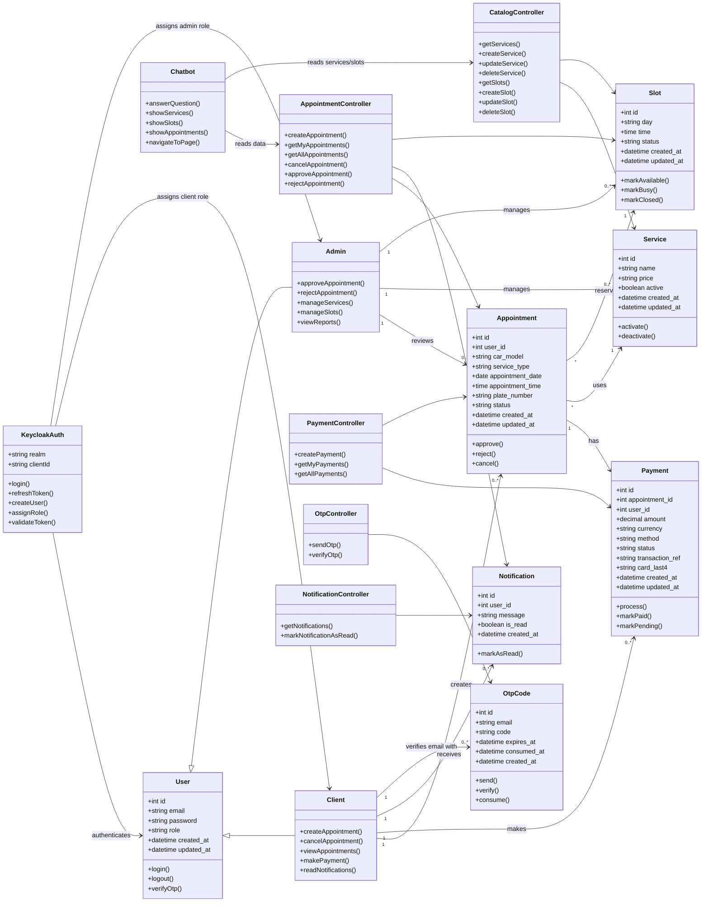

# Hyundai RDV - Class Diagram

## Notes

- `User`, `Client`, and `Admin` are represented by Keycloak users plus the local `users` table.
- `Service` and `Slot` are managed by the admin and stored in MySQL.
- `Appointment` connects the client, selected service, selected slot, vehicle data, and status.
- `Payment` is currently a simulated payment module.
- `Chatbot` is a frontend assistant that reads real app data through the API.
